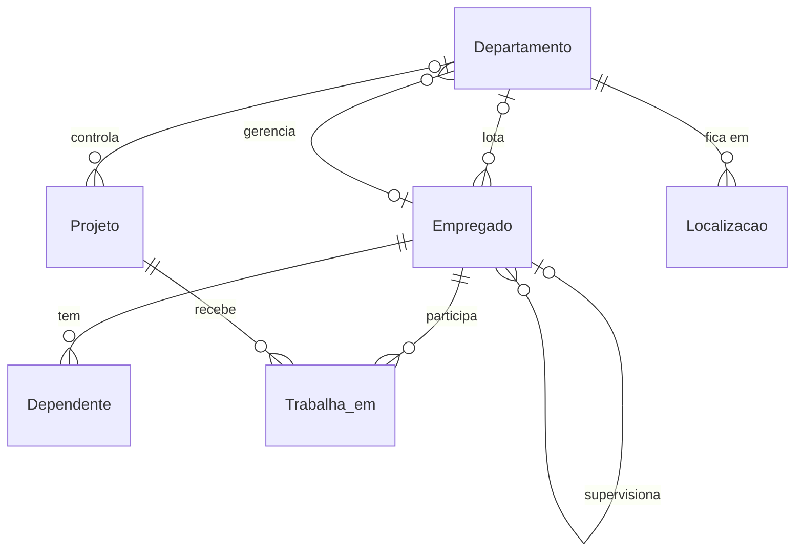

# Exercícios de SQL

Meus exercícios de SQL em MySQL, feitos na disciplina de Laboratório de Banco de Dados do curso de Engenharia de Software da Universidade Católica de Brasília (UCB).

## Lista 1 a 19

Arquivo: [`listas/DML_lista-exercicios-1-19.sql`](listas/DML_lista-exercicios-1-19.sql)

O script cria o banco `empresa`, as tabelas e as chaves estrangeiras, e depois traz as 19 consultas.

### Modelo do banco



### Consultas

| Nº | O que a consulta retorna | Recursos de SQL |
|---|---|---|
| 1 | Empregados do departamento 5 | `WHERE` |
| 2 | Empregados com salário acima de 3000 | `WHERE` |
| 3 | Empregados do departamento 5 com salário acima de 3000 | `AND` |
| 4 | Empregados do departamento 5 com salário acima de 3000, ou do departamento 4 com salário acima de 2000 | `AND`, `OR` |
| 5 | Nome e salário de todos os empregados | Projeção de colunas |
| 6 | Nome e salário dos empregados do departamento 5 | Projeção, `WHERE` |
| 7 | RG dos empregados do departamento 5 e RG dos supervisores deles | `UNION` |
| 8 | Nomes de empregados iguais ao nome de algum dependente | `INNER JOIN`, `DISTINCT` |
| 9 | Todas as combinações entre empregados e dependentes | `CROSS JOIN` |
| 10 | Empregados e seus dependentes | `INNER JOIN` |
| 11 | Departamentos e seus gerentes | `INNER JOIN` |
| 12 | Departamentos e suas localizações | `NATURAL JOIN` |
| 13 | Empregados e os projetos em que trabalham | `INNER JOIN` com 3 tabelas, `ORDER BY` |
| 14 | Empregados que trabalham em projetos do departamento 5 | `INNER JOIN` com 3 tabelas, `DISTINCT` |
| 15 | Total de empregados | `COUNT` |
| 16 | Quantidade de empregados por departamento | `COUNT`, `GROUP BY` |
| 17 | Média salarial por departamento | `AVG`, `GROUP BY` |
| 18 | Nome e endereço dos empregados do departamento Pesquisa | `INNER JOIN`, `WHERE` |
| 19 | Projetos de Londrina, com departamento e gerente responsável | `INNER JOIN` com 3 tabelas |

## Como executar

Precisa do MySQL instalado.

```bash
git clone https://github.com/keitiely/exercicios-sql.git
cd exercicios-sql
mysql -u root -p < listas/DML_lista-exercicios-1-19.sql
```

- As tabelas são criadas sem dados, então as consultas rodam, mas voltam vazias até você inserir registros.
- O script cria o banco `empresa`. Se já existir um banco com esse nome, a execução para com erro.
- No Linux, o MySQL diferencia maiúsculas de minúsculas no nome das tabelas. Nesse caso, ajuste os nomes antes de rodar.

## Autoria

Keitiely Silva Viana · [github.com/keitiely](https://github.com/keitiely)
